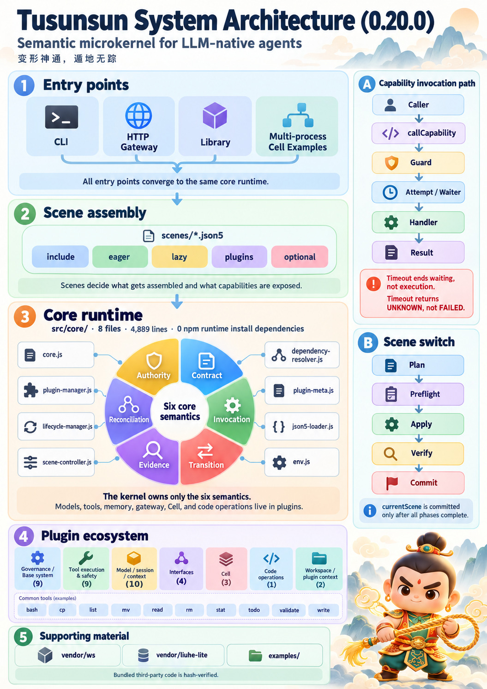
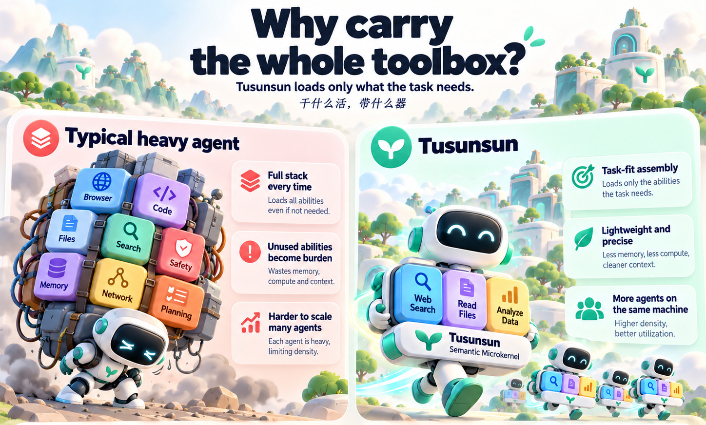
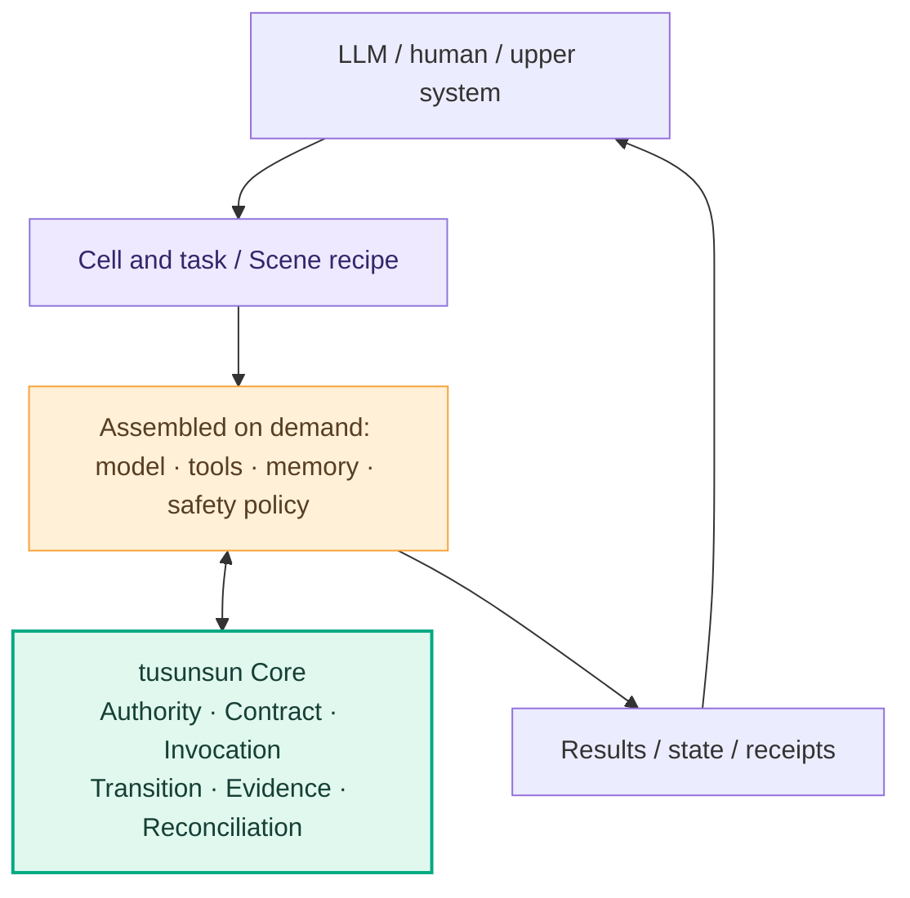
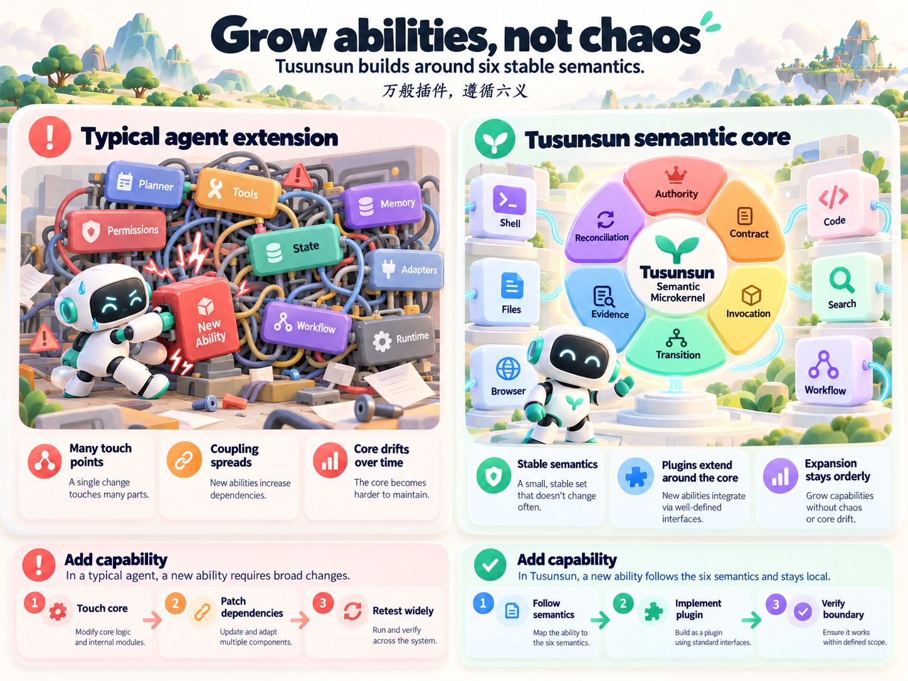
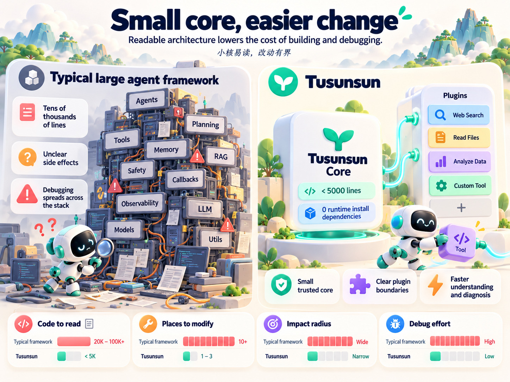

# tusunsun

> ### Shape-shifting powers; moving unseen beneath the ground.
> **A semantic microkernel for LLM-native agents.**

**Load what the job needs; change the job and the capabilities follow.**
**Many plugins, one set of six semantics; organs stay fresh, the kernel stays put.**
**Autonomous in intent, bounded in execution; claims backed by evidence, unknowns never hidden.**

**tusunsun is a semantic microkernel built for LLM agents.** It does not think for the model, and it does not try to ship every capability up front. It provides a small, stable execution base so an agent can assemble models, tools, memory and policies per task — while every part still obeys the same execution rules.

"Shape-shifting" means a unit of work swaps its capability set as the task changes. "Moving unseen" means carrying as little unrelated machinery as possible. **Work can vary endlessly; the kernel does not have to grow with it.**



*One-page architecture: entry points, scene assembly, the 8-file kernel and its plugin groups; on the right, the capability invocation path and the five-phase scene switch. The kernel shown is the `0.20.3` public release.
The itemised list (all 50 plugins) is in [System architecture](docs/architecture/system-architecture.md).*

**The figures ship with the repository only — they are not part of the npm package** (the README is in the package, the images are not, so they render as placeholders on npm).

**Start with the smallest scene (no API key, no network):**

```bash
node tusunsun.mjs --version
node tusunsun.mjs scene list
node tusunsun.mjs scene show chat
```

> **Release status**: `0.20.3` is the current public open-source release (`0.20.0` was the first)
> and is **not published to the npm registry** (`npm view tusunsun` returns 404 — install from source or
> GitHub). This is a **Developer Preview for trusted local environments**; it does not promise
> untrusted-code isolation, cross-process exactly-once, or production readiness on every platform.

---

## 01 · Radical decoupling: why carry the whole toolbox to do one small thing?

Suppose you only want an agent to read a few files and write a report. It needs file reading, search and output. Nothing else.

In a heavily integrated assembly, even a simple task can drag along tools, adapters, dependencies and context it will never touch. **Being able to do a lot is not the same as needing to carry a lot.**

tusunsun's choice: **split capabilities apart, assemble on demand.**

- Pure conversation → the lightweight `chat` scene (3 plugins);
- Code work → file and coding tools (`coding`: 9 plugins plus 1 lazy);
- More capability → add the plugins to the scene (`gateway` declares 28 plugins in total, one optional);
- Lazy-friendly components load on first use (none of the 10 tool plugins under `plugins/tools/` is loaded by default).

| Design question | What tight integration can cost | tusunsun's choice |
| --- | --- | --- |
| Capabilities this task never uses | Load, maintenance or context cost anyway | The scene declares what it needs; the rest stays optional |
| Switching to a different kind of work | Many features entangled in one runtime | Switch scene, or edit the assembly list |
| More units of work on one machine | Per-unit baseline cost grows with the integration | Keep each unit's capability burden small |
| Adding a capability | Easily perturbs existing module relationships | Extend a plugin behind an agreed contract |



*Conceptual comparison: "carry the full toolbox every time" on the left, assembly on demand on the right. The original artwork carried four numeric read-outs (`8.2s / 0.9s`, `120K / 12K`, `70% / 12%`, `1× / 8×`); nothing in this repository can produce or support them, so that strip was cropped out — the figure keeps the qualitative contrast and prints no false precision.*

**The point of decoupling is not to make the agent do less — it is to make every job lighter.** That is also where we want to start if a single machine is to host more independent units of work; the actual density still has to come from like-for-like benchmarks.

## 02 · The six-semantics microkernel: capabilities split apart, so how does anything stay consistent?

Splitting tools into plugins is easy. The hard part is this: as plugins multiply and work shapes keep changing, **who guarantees that authority, execution, state and results still obey one set of rules?**

tusunsun does not define its core by today's feature list. It starts from the facts that recur every time an agent executes work, and abstracts them into six stable semantics:

| Semantics | The question it answers |
| --- | --- |
| **Authority** | Who really owns this capability? Who is allowed to use it? |
| **Contract** | What must a call satisfy? What does the result promise? |
| **Invocation** | Did the request actually enter execution? When does it truly end? |
| **Transition** | How may runtime state legally change? |
| **Evidence** | Which facts actually happened? Which are still unknown? |
| **Reconciliation** | On failure, partial completion or unknown outcome — what happens next? |

These are **not six Managers you install**. They are six classes of constraint the whole runtime obeys, implemented by mechanisms already inside the small Core plus explicit boundaries on the surrounding components.



**One very practical rule: a wait timeout does not mean the tool has stopped.**

An LLM kicks off a file write and then waits too long. The caller may stop waiting, but the write that already started may still be running. tusunsun separates "the waiter timed out" from "the real execution ended". It will not disguise an unknown outcome as a safe failure, and it will not blindly retry without checking.

That is what a semantic kernel buys you: not just an entry point, but an honest answer to **"who ran it, how far did it get, and what actually happened?"**

### Adding a capability — what should change?

In a tightly coupled design, one new capability can drag in scheduling, permissions, state, error handling and the tool interface. The maintenance cost lives in those cross-relationships, not in the plugin itself.

In tusunsun, if the new capability can be expressed with the existing semantics, you work along a much more local path:

**Define the capability contract → implement the plugin → add it to a scene → verify permissions and execution bounds.**

You should not need a new special case in the Core just because you added a tool.



*The six semantics stay put while capabilities grow at the edges: follow the semantics → implement the plugin → verify the boundary.*

**Capabilities grow at the edge; order is kept underneath.**

## 03 · Readable and changeable: a kernel small enough to actually understand

The thing developers fear is not volume — it is **not knowing what else to read and what else to break** for a one-line change. That goes double for LLMs: irrelevant source, tool descriptions and implicit dependencies eat the limited working context.

tusunsun keeps long-lived responsibilities in a small kernel and puts fast-moving business capability into plugins and scenes.

| Engineering fact (measured on 0.20.3) | Value |
| --- | --- |
| Core size | **4,896 lines / 8 files** (`src/core/`, line budget enforced — see ADR-10) |
| External npm runtime dependencies | **0** |
| 0.20.3 tarball | **446 files / ~1.86 MB** (measured with `npm pack`) |
| Plugin scale | **40 root plugins + 10 tool plugins + 22 library files**, 26,211 lines total |
| Bundled third-party code | Yes — `ws` (18 files) and `liuhe-lite` (43 files) ship with provenance and per-file hashes. "No install-time dependencies" is **not** the same as "no third-party code" |

> Line-count convention: the **microkernel is 4,896 lines** across 8 files; the enforced budget is
> **core ≤ 4896 lines** — raising it requires the approval process in ADR-10.

None of this means the whole repository is 4,896 lines, and it does not mean plugins must be short. **What is small is the stable core — not the imagination of the ecosystem.**

When a plugin misbehaves, start from its declaration, lifecycle, call contract and execution receipt. When a capability must change, prefer adjusting the plugin or the scene over touching the control plane.

**For the full layering, all 50 plugins, the 10 scene recipes and three end-to-end paths, see
[the system architecture note](docs/architecture/system-architecture.md).**



*Qualitative comparison: how much source you read, how many places you touch, the impact radius and the debugging cost — the four bars indicate direction only, carry no scale, and are not benchmarks.*

**We want humans to be able to read it, and LLMs too — easy to extend, easy to audit.**

## 04 · Solid: not "the tests pass", but "errors cannot rewrite the rules"

Agents hit anomalies: tools throw, calls time out, plugins reload, state lingers, requests repeat, execution only partly completes. Real stability is not wrapping all of that up as "success" — it is making the system keep obeying its rules precisely when things go wrong.

Examples:

- **Same name is not the same right**: a capability name never substitutes for the real owner and credential.
- **Timeout is not termination**: a waiter leaving does not erase execution still in flight.
- **An event is not a committed fact**: an observer failing may not rewrite committed state.
- **Successful execution is not acceptance**: artefacts and acceptance need independent evidence.

tusunsun builds invariants, contracts, positive and negative examples and regression tests around the six semantics. Design review uses the "four questions and one cross-check" method to pin down authority, source of truth and boundaries, and higher-risk changes get formal constraints and verification where appropriate. **The method is not the proof; re-runnable counterexamples and checkable results are.**

Measured in the `0.20.3` three-platform CI (run `42053032645`):

| Check | Public source checkout | npm artifact (unpacked) |
| --- | ---: | ---: |
| Unit tests | **1,537 / 1,537 pass** (Ubuntu) | same suite passes; repo-level cases recorded as NOT_RUN |
| Integration | **74 / 74 pass** (Ubuntu) | same suite passes; browser prerequisites recorded as NOT_RUN when absent |
| Smoke | **2 / 2** | **2 / 2** |
| Counterexample probes | 27 probes (0.20.2 measurement; the kernel is unchanged) | same (probes ship with the package) |
| Release gate | run separately per the release checklist; SKIP is never counted as pass | same |

**Why the artifact form does not sign off as all-green**: the artifact ships without `verification/`, `.github/` and `package-lock.json`; those repo-level cases are recorded as NOT_RUN and **never counted as passes**. The two numbers answer two different questions and never stand in for each other.

> The release gate is run separately per the release checklist; a public source checkout missing a few evidence scripts records those items as SKIP / NOT_RUN instead of counting them as PASS. Unit, integration, smoke and probe counts come from the public tree and the three-platform CI.

These are measurements of **one version in one environment**. They do not mean every platform, every model and every security property has been formally proven.

## 05 · Safety: make the LLM think one step further, and make over-reach impossible to talk past

Ask an agent to "clean up temp files". It proposes a recursive delete — but does it remove three caches, or the whole project?

"Please be careful" in a prompt is not enough. tusunsun splits risk handling across layers:

**One layer is execution eligibility.** A call must pass the applicable identity, capability and permission checks; an unauthorised call is refused before it reaches the real tool. A Cell's effective capabilities are further constrained by host policy, its CellSpec and the current Task.

**Another layer is an attention gate for dangerous operations.** For operations that cannot be undone, the tool layer can first measure the blast radius and return a confirmation question, requiring the caller to state necessity, scope, recoverability and the affected targets before proceeding. Commands that are explicitly forbidden are hard-rejected.

**The Y025 confirmation is attention, not human approval and not a sandbox**: it first asks the caller to see the blast radius. Whether to continue is the caller's decision from what is visible, and the executor still has the final say. The `needs_reasoning` result enters the next model turn as a tool result (not folded into `Error`), the model retries from the visible `files` / `scope`, and the audit records `ack_by: 'model-restatement'` with `human_approved: false`.

Fence installation and enforcement must share one source: if `fenceStatus()` says installed, it must actually block; `full-auto` only waives confirmation, not sensitive-path, path-boundary, read-before-write, circuit-breaker or rate-limit checks.

Finally, **receipts must separate intent from fact**: the model saying "I deleted it" is not the same as the files having been removed as intended; and if a side effect partly happened, it cannot simply be reported as "failed, nothing to do".

One boundary has to be stated plainly: **tusunsun's permission gate is logical control, not an OS-level sandbox.** Trusted in-process plugins and an unrestricted `tool-bash` cannot be treated as isolated untrusted code, and the dangerous-operation machinery does not guarantee stopping a malicious tool that already has execution rights. The primary scope today is trusted local environments.

**Give the LLM freedom to act, and give every action an explicit boundary and an honest record.**

## 06 · Cell: today's smallest unit of work, tomorrow's more general one

An agent should not be permanently welded to one fixed capability set. And looking further out, work will not always be done by a single agent.

So tusunsun introduces **Cell**: an execution subject with its own identity, work boundary, capability view and lifecycle. It can take a task, execute, deliver and close — and **a Cell is not a Task, not a Session, and not another name for the Core.**

Today you can run a single Cell, and demonstrate two-Cell work plus failure reclamation with **two independent processes**:

```bash
node examples/cells/single-cell.mjs
node examples/cells/dual-cell.mjs
node examples/cells/dual-cell.mjs --fail-b
```

These examples verify the execution contract without calling a real cloud model.

Further out we want to explore task-driven splitting, dynamic composition, cross-device collaboration, and eventually robot Cells where each physical unit runs its own kernel. But **autonomous splitting, multiple Cells in one process, distributed exactly-once, and robot hardware deployment are not capabilities this open-source package delivers today**.

**Why define Cell first?** Because whatever the future unit of work looks like — bigger, smaller, running anywhere — it should first be able to answer: who am I, what can I do, what am I doing, and did it work.

## 07 · Performance: as models get faster, the execution base must not become the new bottleneck

When an LLM decision drops from seconds to tens of milliseconds, the framework's extra waiting, assembly and tool-call overhead stops being negligible.

tusunsun aims for **short execution paths, little install burden, assembly on demand**. The numbers come from reproducible tests, not from the word "microkernel".

What follows is a **historical baseline** (i7-8750H / Node 22; previous stress round:
`docs/quality/stress-baseline-2026-10-20.md`, source checkout only; it is **not** a re-run of this version):

| Metric | Historical measurement |
| --- | ---: |
| Cold start to serviceable | **~122 ms** (minimal assembly); **160 ms** (coding scene) |
| Resident memory | **~65–67 MB** (including the Node runtime and assembled components) |
| Tool safety decision | **~7.2 µs per call** |
| Framework overhead in a full chat round trip | **~1.3–4.9 ms** (measured against a locally simulated upstream) |

Different scenes, machines, models and concurrency change these numbers. They also cannot be turned into "N times faster than framework X" or "can host N Cells". What we care about more: **what does each extra capability, and each extra unit of work, actually cost?**

### Same-machine comparison (2026-10-31, N=30)

These numbers were measured on the **development-line `0.20.1` tree** against opencode 1.18.29;
the public `0.20.3` tree has not been re-run. Both kernels are the same 8 files; the differences are
public-release comment edits and a Windows scene-path fix (36 bytes net). `0.20.2` added the Y025 model-closure parameters and challenge text, and `0.20.3` adds session-control fields, so per-turn context may shift slightly — keep the
"measured on the 0.20.1 tree" premise when quoting, and do not present these as a 0.20.3 re-run.

Method: startup = `spawn → HTTP ready endpoint returns <500`; memory = `VmRSS` 1.2 s after ready;
context = one real request body captured by a local recorder; density = N independent `gateway`
processes on one machine. Full method and raw samples are in the
[system-bench report](docs/quality/system-bench-2026-10-31.md).

| Metric | tusunsun `gateway` | opencode `serve` / `run` |
| --- | ---: | ---: |
| Start to serviceable (spawn → HTTP ready <500, p50 / p95) | **153 / 162 ms** | **1205 / 1238 ms** |
| Resident memory once ready (VmRSS, p50) | **71.4 MB** | **326.9 MB** |
| Fixed per-turn context (real `prompt_tokens`) | **1,548** | **7,347** |
| 16 instances on one machine | **1,149 MB total / 71.8 MB each / 0 failures** | not measured |

The floor (`node -e ""`) is **27 ms** — subtract it and the framework tax is **126 ms vs 1179 ms**.
"Real `prompt_tokens`" means the captured request body was replayed once against `deepseek-v4.1-flash`
and read back from `usage`; the estimator was within 16% and 4% respectively, and both numbers are in the report.

Re-run on a Linux source checkout: `node verification/perf/system-bench.mjs --no-opencode` (tusunsun only);
the opencode comparison needs opencode 1.18.29 installed. The script and raw JSON ship with the source checkout,
not the npm package.

**What these numbers may not be used for**: not "8× faster" (the two capability surfaces differ by an
order of magnitude — opencode carries a TUI, LSP, MCP and a session store), not "8× density" (the other
side was not measured, and 327 MB per instance would take this machine down first), and not "70% less
resident memory" (the relative gap is 78%, but that counts the features the other side actually performs).
They are the assembly tax on **one machine under one external criterion**; re-run before quoting.

## 08 · Start from a small kernel, assemble your own agent

tusunsun is not a finished assistant with all the tools pre-picked. It gives you **composable foundations**: start from `chat`, `coding`, `gateway`, `cell` and adjust models, file tools, memory, safety and business plugins as needed.

Code-operating capability such as `liuhe-lite` is an organ that evolves on its own, not a responsibility the Core should carry forever.

### Install

The package is **not published to the npm registry** (`npm view tusunsun` returns 404), so there is no
one-line `npm install -g` path today. Two ways that actually work:

```bash
# 1) Run straight from the repository
git clone <repo> && cd tusunsun
node tusunsun.mjs scene list

# 2) Build a tgz and install that
npm pack                      # produces tusunsun-0.20.3.tgz
npm install -g ./tusunsun-0.20.3.tgz
```

Without a global install, replace `tusunsun` with `node tusunsun.mjs`.

### Connect a model

The **default model name is `kimi-k2.5`** (the fallback in `plugins/model-openai.js`, overridable by
config). A real model needs an OpenAI-compatible endpoint, a model name and an API key.

**What happens without a key**: offline commands (`--version`, `scene list/show`, the Cell examples)
keep working; a real chat call returns a **named upstream error** rather than silently becoming an
empty reply. Scene enumeration and the deterministic examples never touch the network.

In the browser, type the passphrase into the **login box**; it is kept in `sessionStorage` and never
placed in the URL.

### First steps

With a source checkout or tarball in hand, using Node.js 22:

```bash
# See which scenes exist and what a scene assembles
node tusunsun.mjs scene list
node tusunsun.mjs scene show gateway

# Start the local service (listens on localhost only by default)
node tusunsun.mjs start
```

To connect a real model, configure the OpenAI-compatible endpoint, model name and API key. Offline checks, scene enumeration and the deterministic Cell examples need no model credentials.

> **Boundaries**: trusted-local and internal integration are usable; the public OSS Developer Preview
> artifact is **not published to npm** — use the public `0.20.3` tree. We do not promise
> untrusted-code isolation, cross-process exactly-once, or production readiness on every platform.

For more detail see
[the system architecture note](docs/architecture/system-architecture.md),
[the scene guide](docs/guides/scene-system.md),
[the plugin development guide](docs/guides/plugin-development.md),
[the ADRs](docs/adr/),
[SECURITY.md](SECURITY.md) and [the core invariants](docs/architecture/core-invariants.md).
Start from a real task, give it your own capabilities, and help us test whether these semantics hold.

---

**Shape-shifting: capability follows the task.**
**Moving unseen: the foundation stays light enough not to get in intelligence's way.**

**Keep the kernel small. Let intelligence take shape.**
