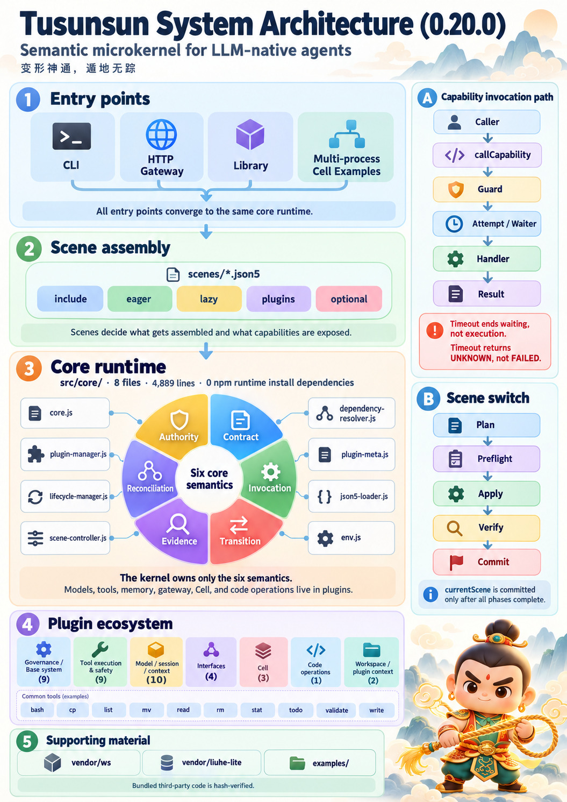
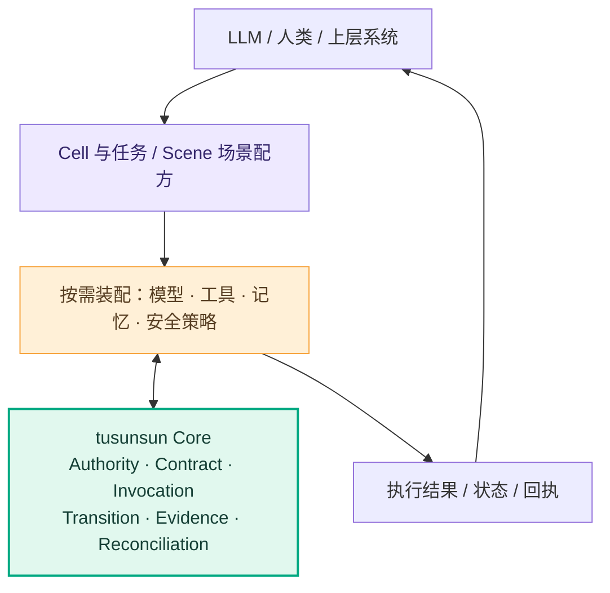
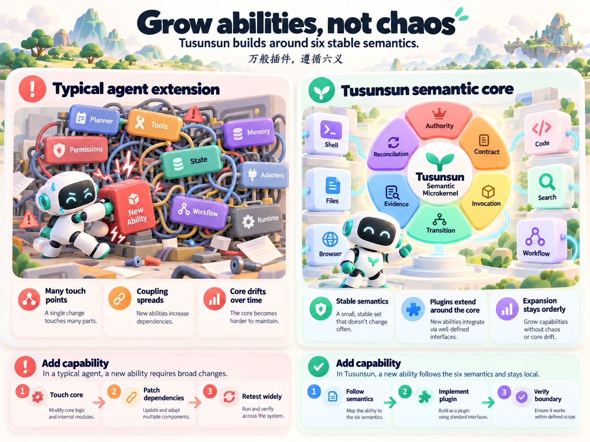
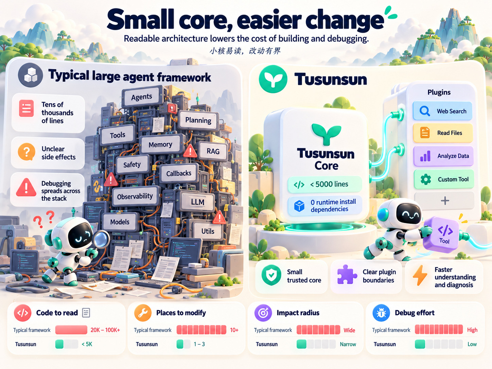

# 土行孙 · tusunsun

> ### 变形神通，遁地无踪。
> **A semantic microkernel for LLM-native agents.**

**干什么活，装什么器；任务一换，能力随变。**
**万般插件，遵循六义；器官常新，内核常定。**
**智能自主，执行有界；行动有据，未知不瞒。**

**土行孙是为 LLM Agent 设计的语义微内核。** 它不替模型思考，也不试图内置一切能力；它提供一套小而稳定的执行基础，让 Agent 按工作需要装配模型、工具、记忆和策略，同时遵守共同的执行规则。

所谓「变形」，是让工作单元随任务更换能力组合；所谓「遁地」，是尽量不背负无关组件，把运行负担降到必要的程度。**工作可以千变万化，内核不必随之膨胀。**



*一页架构图：入口形态、场景装配、8 文件内核、插件分组；右侧是能力调用路径与场景切换的五段式。图为 `0.20.2` 公开版的内核。
逐项清单（全部 50 个插件）见 [系统架构说明](docs/architecture/system-architecture.md)。*

**插图只随仓库分发，不在 npm 包内**（README 在 npm 包里，图不在 —— npm 页面上这四张会是占位图）。

**从一个最小场景开始（无需 API Key、无需联网）：**

```bash
node tusunsun.mjs --version
node tusunsun.mjs scene list
node tusunsun.mjs scene show chat
```

> **发布状态**：`0.20.2` 是当前公开开源版（首个公开版为 `0.20.0`），**尚未发布到 npm registry**
> （`npm view tusunsun` 返回 404，请从源码或 GitHub 获取）。
> 当前面向**可信本地环境的 Developer Preview**；
> 不承诺不可信代码隔离、跨进程 exactly-once 或所有平台的生产级运行。

---

## 01 · 极致解耦：为什么干一件小事，要背整个工具箱？

假设你只想让 Agent 读取几个文件、整理一份报告。它需要的可能只有文件读取、搜索和输出能力。

但在高度集成的装配方式中，一个简单任务也可能带着暂时用不到的工具、适配器、依赖和上下文。**会做得多，不等于每次都该带得多。**

土行孙的选择是：**能力拆开，按需装配。**

- 纯对话，使用轻量对话场景（`chat`，3 个插件）；
- 处理代码，加入文件和编码工具（`coding`，9 个插件 + 1 个懒加载）；
- 需要更多能力，再把对应插件装进场景（`gateway` 共声明 28 个插件，其中 1 个可选）；
- 适合懒加载的组件，用到时再加载（`plugins/tools/` 那 10 个工具插件默认都不在）。

| 设计问题 | 高度集成式装配可能付出的代价 | tusunsun 的选择 |
| --- | --- | --- |
| 这次任务用不到的能力 | 仍可能增加加载、维护或上下文成本 | 场景声明必要能力，其他保持可选 |
| 换一类工作 | 大量功能在同一运行体中纠缠 | 换场景或修改装配清单 |
| 同机运行更多工作单元 | 单元基础成本可能随集成规模增长 | 尽量降低每个单元的能力负担 |
| 增加一种能力 | 容易影响既有模块关系 | 在约定接口上扩展插件 |


*概念对比：左为「每次都背满工具箱」的典型形态，右为按需装配。原图底部还有四组数字
（`8.2s / 0.9s`、`120K / 12K`、`70% / 12%`、`1× / 8×`），本仓没有任何同条件基准能支持它们，
也没有脚本能产出它们，所以那条数值带被裁掉了：图只留定性方向，不印伪精度。*

**解耦的价值，不是让 Agent 少做事，而是让它完成每件事时更轻盈。** 这也是我们希望在同一台机器上容纳更多独立工作单元的起点；具体密度仍须由同条件基准测试回答。

## 02 · 六语义微内核：能力拆开了，怎样保证不乱？

把工具分成插件并不难。难的是：当插件越来越多、工作形态不断变化时，**谁来保证授权、执行、状态和结果仍遵守同一套规则？**

土行孙不以今天有哪些功能来定义核心，而从 Agent 执行工作时反复出现的基本事实出发，抽象为六种稳定语义：

| 六大语义 | 它回答的问题 |
| --- | --- |
| **Authority · 权属** | 谁真正拥有这项能力？谁有权使用？ |
| **Contract · 契约** | 调用必须满足什么约束？结果承诺什么？ |
| **Invocation · 执行** | 请求是否真的进入执行？何时真正结束？ |
| **Transition · 转移** | 运行状态如何合法改变？ |
| **Evidence · 观测** | 哪些事实确实发生了？哪些还不能确定？ |
| **Reconciliation · 收敛** | 失败、部分完成或结果未知时，如何处理后续？ |

这**不是六个需要安装的 Manager**，而是整个运行时共同遵循的六类约束。它们由小型 Core 的既有机制与外围组件的明确边界共同落实。



**一条很实际的规则：等待超时，不代表工具已经停下。**

例如，LLM 发起写文件操作后等待超时：调用方可以停止等待，但已经开始的写入可能仍在继续。土行孙要区分「等待者超时」与「真实执行结束」，不能把未知后果伪装成安全失败，更不能不经核对就盲目重试。

这就是语义内核的价值：它不仅提供调用入口，更努力让 **「谁执行、执行到哪一步、实际发生了什么」** 始终说得清。

### 增加一种新能力，应该改变哪里？

在强耦合设计中，一种新能力可能牵动调度、权限、状态、异常处理和工具接口。维护成本往往不在插件本身，而在这些交叉关系。

在土行孙中，如果新能力能够用既有语义表达，开发者通常可以沿着更局部的路径工作：

**定义能力合同 → 实现插件 → 纳入场景 → 验证权限与执行边界。**

不必因为增加一个工具，就给 Core 增加一个新的特殊规则。



*六语义不变，能力在外围生长：遵循语义 → 实现插件 → 验证边界。*

**能力在外围生长，秩序在底层保持。**

## 03 · 易读易改：一个小到可以真正理解的内核

开发者最怕的不是代码多，而是**为改一件小事，不知道还要看哪里、会碰坏哪里。** 对 LLM 更是如此：不相关的源码、工具说明和隐式依赖，都会消耗有限的工作上下文。

土行孙将长期稳定的职责留给小内核，将多变的业务能力放到插件和场景中。

| 工程事实（0.20.2 实测） | 数值 / 范围 |
| --- | --- |
| Core 规模 | **4,889 行 / 8 文件**（`src/core/`，有行数预算，见 ADR-10） |
| 外部 npm 运行时安装依赖 | **0** |
| 0.20.2 压缩包 | **439 个文件 / 约 1.82 MB**（`npm pack` 实测） |
| 插件规模 | **40 个根插件 + 10 个工具插件 + 22 个库文件**，共 25,522 行 |
| 内置第三方代码 | 有；随包 `ws`（18 文件）与 `liuhe-lite`（43 文件）有来源与逐文件哈希校验——不能把「免安装依赖」说成「没有第三方代码」 |

> 行数口径：**微内核 4889 行**（`src/core/` 八个文件合计），预算是 **核心 ≤ 4889 行** ——
> 上调必须走 [ADR-10](docs/adr/ADR-10-core-line-budget.md) 的批准程序，不能"顺手加两行"。

这些数字不代表整个仓库只有 4,889 行，也不代表插件必须写得很短。**小的是稳定核心，不是生态的想象力。**

当一个插件失效，可以先看它的声明、生命周期、调用合同与执行回执；当一种能力需要变化，优先调整插件或场景，而不是修改控制平面。

**完整的分层、全部 50 个插件、10 个场景配方与三条端到端路径，见
[系统架构说明](docs/architecture/system-architecture.md)。**



*定性对比：源码要读的量、要改的处数、影响面、调试成本 —— 四组条形只表方向、不标刻度，不是基准测试。*

**我们希望人类能读懂它，LLM 也能读懂它；既方便扩展，也方便审查。**

## 04 · 坚固：不是测试能跑过，而是错误不能把规则改掉

Agent 会遇到异常：工具抛错、超时、插件重载、状态残留、重复请求、部分执行……真正的稳定，不是把这些情况都包装为「成功」，而是让系统在异常时仍遵守原来的规则。

例如：

- **同名不等于同权**：能力名称不能代替真实所有者和授权凭据。
- **超时不等于终止**：等待退出，不能抹去仍在进行的执行。
- **事件不等于事实提交**：观察者失败，不能反过来改写已提交状态。
- **执行成功不等于验收通过**：真正的产物与验收要有独立证据。

土行孙围绕六语义建立不变式、合同、正反例和回归测试；设计审查采用「四问一照」等方法识别权威、事实来源与边界，关键风险再使用适当的形式化约束与验证手段。**方法本身不是证明；能复跑的反例和可核验结果才是。**

在 `0.20.2` 的 Linux x64 / Node 22.22.2 实测中：

| 检查 | 公开树源码检出 | npm 制品（解包后） |
| --- | ---: | ---: |
| 单元测试 | **1,521 / 1,521 通过 / 0 失败 / 0 跳过** | **1,521 总 / 1,511 通过 / 0 失败 / 10 跳过** |
| 集成测试 | **63 / 63** | **63 / 63** |
| 冒烟测试 | **2 / 2** | **2 / 2** |
| 反例探针 | **27 套探针全部 rc=0** | 同左（探针随包） |
| 发布门禁 | **PASS 42 / FAIL 0 / SKIP 0 / NOT_RUN 2**（完整证据树） | **PASS 32 / FAIL 0 / SKIP 4 / NOT_RUN 7**（不签「全绿」） |

**为什么制品形态不签全绿**：制品不带 `verification/`、`.github/` 与 `package-lock.json`，
所以 10 条单测跳过、4 项 SKIP、7 项 NOT_RUN **全部逐条有理由**，不折算为通过。
两个数回答的是两个问题，不互相顶替。

> 门禁四元组来自**带完整 `verification/` 的开发线证据树**；公开仓源码检出缺少数个证据脚本时，
> 对应项会按 SKIP / NOT_RUN 记账，不会折算成 PASS。单测、集成、冒烟与探针数则是公开树实测。

这些是**特定版本和环境**的实测，不代表所有平台、所有模型、所有安全性质都已获得形式化证明。

## 05 · 安全：让 LLM 多想一步，也让越权无法靠嘴绕过

假设你让 Agent「清理临时文件」。它给出一条递归删除命令，但删的究竟是三份缓存，还是整个项目？

靠一句提示词「请谨慎操作」并不充分。土行孙把风险处理拆成不同层次：

**一层是执行资格。** 调用必须通过适用的身份、能力与权限检查；无权调用，应在进入真实工具前被拒绝。Cell 的有效能力还受宿主策略、CellSpec 与当前 Task 的共同约束。

**另一层是危险操作的注意力闸门。** 对一些不可恢复操作，工具层可以先测量影响范围、返回确认问题，要求调用者明确必要性、范围、可恢复性与影响对象，再继续执行。对明确禁止的危险命令，则执行硬拒绝。

**Y025 的确认是注意力确认，不是人工批准，也不是沙箱**：它先要求调用者看到影响面；是否继续由调用者按可见信息决定，执行器仍有最终判决权。`needs_reasoning` 会作为工具结果进入下一轮模型输入（不折成 `Error`），模型按可见的 `files` / `scope` 重试；审计记录 `ack_by: 'model-restatement'` 与 `human_approved: false`。

围栏的安装与判据必须同源：`fenceStatus()` 报已装配，就必须真的在拦；`full-auto` 只豁免确认，不关闭敏感路径、路径边界、读前必读、熔断与限流。

最后，**回执必须区分意图与事实**：模型说「我删完了」并不等于文件已经按预期删除；发生了部分副作用，也不能简单报告「失败、无需处理」。

这里有一条必须说清的边界：**当前土行孙的权限门是逻辑控制，不是 OS 级沙箱。** 同进程受信插件和不受限 `tool-bash` 不能被当作不可信代码隔离；危险操作机制也不保证能阻止具有执行权限的恶意工具。当前以可信本地运行环境为主要适用范围。

**给 LLM 行动的自由，也给每一次行动明确的边界和事实。**

### 随包存在 ≠ 默认装配 ≠ 需主动启用

这三个身份经常被读成一件事，所以逐条写清：

- **捆仙索本地护栏**（`kunxiansuo-local`）**随包存在**，但**默认场景不装配**它；`coding` 与 `file-txn`
  显式把它写进了 `eager`。所以"默认有安全底座"是个误解 —— 默认没有。
- **戒尺**刻意不含、不随包：它校验护栏自身的锚点哈希，而本项目持续升级、持续改这些文件，
  锚点必然过期。留着只会变成一条永远红的假告警。
- **外部审查/诊断服务**不随包，也不默认装配：开源版不含它们的只读依赖库。
- 真正默认生效的是 **Y025 破坏面闸门**：遇到**不可恢复**操作时，先要求说清必要性、范围、
  可恢复性与**影响面**，再决定是否继续。

本包的适用范围是**可信本地环境**（trusted-local-only）：它提供的是逻辑控制，不是进程隔离。

## 06 · Cell：今天的最小工作单元，明天的更多种可能

一个 Agent 不应该永远是一套固定的能力组合。更长远地看，工作也未必永远由同一个智能体独自完成。

因此，土行孙引入 **Cell**：一个具有独立身份、工作边界、能力视图与生命周期的执行主体。它可以接收任务、执行、交付和关闭；**Cell 不是 Task，不是 Session，也不是 Core 的别名。**

今天已经可以运行单 Cell，并以**两个独立进程**演示双 Cell 工作和失败回收：

```bash
node examples/cells/single-cell.mjs
node examples/cells/dual-cell.mjs
node examples/cells/dual-cell.mjs --fail-b
```

这些例子可以在不调用真实云模型的情况下验证执行合同。

未来我们希望探索按任务分裂、动态组合、跨设备协作，乃至每个物理单元独立运行内核的机器人 Cell。但**自主分裂、同进程多 Cell、分布式 exactly-once 与机器人硬件部署，当前都不支持**——它们是方向，不是本包已交付的能力。

**为什么先定义 Cell？** 因为无论未来的工作单元有多大、多小、运行在哪里，都应该先能回答：它是谁、能做什么、正在做什么、做成了没有。

## 07 · 性能：模型越来越快，执行底座不能成为新瓶颈

当 LLM 一次决策从数秒缩短到数十毫秒，框架额外增加的等待、装配和工具调用开销就不再可以忽略。

土行孙追求**短执行路径、少安装负担、按需装配**；具体表现交给可复现测试，而不是凭「微内核」三个字推断。

以下是**历史基线**（i7-8750H / Node 22，上一轮压测：`docs/quality/stress-baseline-2026-10-20.md`，
仅源码检出；**不是本版重跑的结果**）：

| 指标 | 历史实测 |
| --- | ---: |
| 冷启动到可服务 | **约 122 ms**（最小装配）；**160 ms**（编码场景） |
| 常驻内存 | **约 65–67 MB**（包含 Node 运行时及已装配组件） |
| 工具安全判定 | **约 7.2 μs / 次** |
| 完整对话往返中的框架增量开销 | **约 1.3–4.9 ms**（本地模拟上游的对照测量） |

不同场景、机器、模型和并发条件会改变结果。这些数字也不能直接推出「比其他框架快多少倍」或「可以并发多少个 Cell」。我们更在乎的是：**每增加一项能力、每增加一个工作单元，真实付出了多少成本。**

### 同机对照实测（2026-10-31，N=30）

这组数字在**开发线 `0.20.1` 树**上测得，对照物是 opencode 1.18.29；公开仓 `0.20.2` 尚未重跑。
两个内核同为 8 文件，差异是公开化注释与 Windows 场景路径修正（净 36 字节）。
`0.20.2` 的 Y025 模型闭环增加了工具参数声明与挑战文本，回合上下文可能略有变化 ——
引用这组数字时请保留“0.20.1 测量树”的前提，不要把 `0.20.2` 说成已按同一口径重跑。

量法：启动 = `spawn → HTTP 就绪端点返回 <500`；内存取就绪后 `VmRSS`；上下文取一轮真实请求体（recorder 抓包）；
密度 = 同机同时拉起 N 个独立 `gateway` 进程。完整方法与原始样本见
[system-bench 报告](docs/quality/system-bench-2026-10-31.md)。

| 指标 | 土行孙 `gateway` | opencode `serve` / `run` |
| --- | ---: | ---: |
| 启动到可服务（spawn → HTTP 就绪 <500，p50 / p95） | **153 / 162 ms** | **1205 / 1238 ms** |
| 就绪后常驻内存（VmRSS，p50） | **71.4 MB** | **326.9 MB** |
| 每回合固定上下文（真模型 `prompt_tokens`） | **1,548** | **7,347** |
| 同机 16 个实例 | **1,149 MB 总 / 每实例 71.8 MB / 0 失败** | 未测 |

地板（`node -e ""`）是 **27 ms** —— 扣掉它，框架税是 **126 ms vs 1179 ms**。
上下文那一行的“真模型”指把抓到的请求体重放给 `deepseek-v4.1-flash` 一次、读 `usage.prompt_tokens`
（估算值与实测值误差在 16% 与 4% 以内，两个数都记在报告里）。

复跑：在 Linux 源码检出上运行 `node verification/perf/system-bench.mjs --no-opencode`（只量土行孙）；
带 opencode 对照需本机有 opencode 1.18.29。脚本与原始 JSON 随源码检出，不进 npm 包。

**这些数字不能这么用**：不是“快 8 倍”（两边能力面差一个数量级：opencode 带 TUI/LSP/MCP/会话库），
不是“并行密度 8×”（对侧没测，且 327 MB/实例在这台机器上会先把机器放倒），
也不是“常驻省 70%”（相对差是 78%，但那把人家多做的功能也算了进去）。
它们是**同一台机器、同一个外部口径**下的装配税；换机器、换版本必须重跑。

## 08 · 从小内核出发，组装你自己的 Agent

土行孙不是替你预先选好所有工具的成品助手。它提供的是**可组合的基础**：你可以从 `chat`、`coding`、`gateway`、`cell` 等场景开始，按需要调整模型、文件工具、记忆、安全机制和业务插件。

六合 Lite 等代码操作能力属于可以独立演化的外围器官，而不是 Core 必须长期背负的职责。

### 安装

包**尚未发布到 npm registry**（`npm view tusunsun` 返回 404），所以现在没有"一行 `npm install -g` 就能用"的路径。当前真正可用的两种获取方式：

```bash
# ① 从仓库直接跑（推荐：所有离线命令都可用）
git clone <仓库地址> && cd tusunsun
node tusunsun.mjs scene list

# ② 自己打一个 tgz 再装
npm pack                      # 产出 tusunsun-0.20.2.tgz
npm install -g ./tusunsun-0.20.2.tgz
```

### 常用命令

| 命令 | 作用 |
|---|---|
| `tusunsun scene` | 场景管理：list / expand / show / current / switch / suggest |
| `tusunsun start` | 启动本地网关（默认只监听本机） |
| `tusunsun stop` | 停止正在运行的网关 |
| `tusunsun status` | 查看网关状态 |
| `tusunsun config` | 查看或修改配置 |
| `tusunsun plugins` | 列出 `plugins/` 下可装载的插件文件 |
| `tusunsun workspace` | 会话级工作目录（list / release） |
| `tusunsun chat` | 交互式对话（由 `haotian-lite` 插件提供） |
| `tusunsun tui` | 终端 TUI 面板（插件命令） |

没装到全局时，把 `tusunsun` 换成 `node tusunsun.mjs` 即可。最常用的三条：

```bash
node tusunsun.mjs scene list
node tusunsun.mjs scene show gateway
node tusunsun.mjs start
```

### 接入模型

**默认模型名是 `kimi-k2.5`**（`plugins/model-openai.js` 的兜底值，可用配置覆盖）。接入真实模型需要一个 OpenAI 兼容端点、模型名与 API Key。

**没有 key 会怎样**：离线命令（`--version`、`scene list/show`、Cell 示例）照常工作；一旦走真实对话，模型调用会以**具名的上游错误**返回，不会静默变成空回复。场景枚举与确定性示例完全不碰网络。

浏览器访问网关页面时用**登录框**输入口令即可，口令只存在 `sessionStorage`，不写进 URL，也不靠链接里的参数传递。

> **边界**：可信本地 / 内部集成可以试用；公开 OSS Developer Preview 的**制品尚未发布到 npm**，
> 请以公开仓 `0.20.2` 为准。当前不承诺不可信代码隔离、跨进程 exactly-once 或所有平台的生产级运行。

更多细节见
[系统架构说明](docs/architecture/system-architecture.md)、
[场景指南](docs/guides/scene-system.md)、
[插件开发指南](docs/guides/plugin-development.md)、
[架构决策记录](docs/adr/)、
[SECURITY.md](SECURITY.md) 与 [内核不变式](docs/architecture/core-invariants.md)。
希望你从一个实际任务出发，给它装上自己的能力，也帮助我们检验这套语义是否足够稳固。

---

**变形神通，是能力随任务而变。**
**遁地无踪，是底座尽量轻到不妨碍智能。**

**Keep the kernel small. Let intelligence take shape.**
